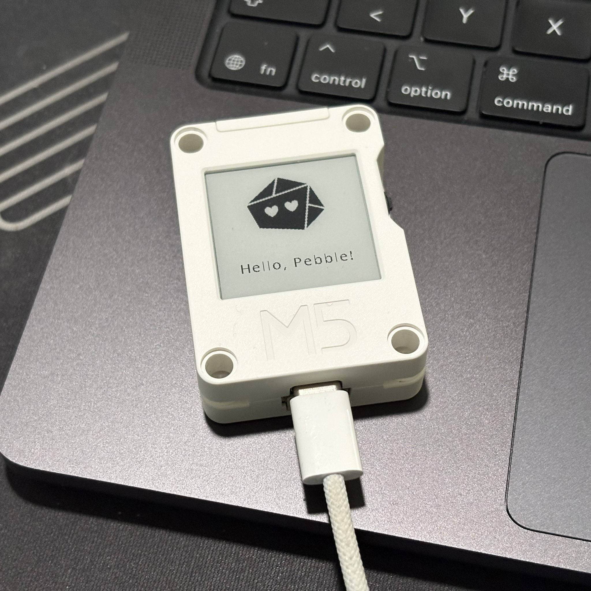

# CoreInk Face

An expressive little e-paper companion. Send a message, choose a face, and let it sit on your desk.

[](https://github.com/nibzard/coreink-face/actions/workflows/ci.yml)
[](https://github.com/nibzard/coreink-face/actions/workflows/firmware.yml)
[](LICENSE)

<p align="center">
  
</p>

CoreInk Face connects a TypeScript library, a Cloudflare API, and firmware for the **M5Stack CoreInk**: a 200 × 200 monochrome e-paper display with a built-in battery. Pick from 35 expressions, write your own selection rules, or let Jev choose an expression from a message or application state. The library also works independently of the hardware.

**[Send a message to Pebble →](https://pebble-little-moments.niko370669.chatgpt.site)** · [Browse all 35 faces](assets/faces/face-map.svg) · [Firmware setup](firmware/README.md)

The public inbox queues messages for Nikola’s device, with no shared cooldown. Messages wait while the device is offline or browsing history, then advance after the device acknowledges rendering. A successful send confirms durable queuing, not delivery. The inbox explains the limited sender metadata saved with each message in its privacy notice.

## Start here

| I want to… | Start with |
| --- | --- |
| Try it without setting anything up | [Public Pebble inbox](https://pebble-little-moments.niko370669.chatgpt.site) |
| Put it on my own CoreInk | [Device setup](#set-up-a-coreink) |
| Use faces in an app or agent | [TypeScript library](#use-the-typescript-library) |
| Publish updates from my application | [API client](#publish-to-a-device) |
| Host my own backend | [API deployment](#run-your-own-api) |

## How it works

Your application sends a face, message, or state to the API. Queued messages are classified once and delivered in acceptance order; direct display updates remain available. The CoreInk wakes, fetches a display, redraws when pixels change, acknowledges it, and returns to sleep. Face artwork and fonts live on the device, so it can retain its display through network outages.

- **Choose how expressions work.** An explicit face needs no AI. Rules and custom `FaceChooser` implementations use the same contract; Jev is optional.
- **Keep the words you wrote.** Classification selects an expression without rewriting the message. The device wraps text onto two lines, with a matching preview in the public inbox.
- **Build beyond the device.** The library has zero runtime dependencies and ships ESM, TypeScript declarations, SVG artwork, and an HTTP client.

## Set up a CoreInk

1. [Run your own API](#run-your-own-api) and create separate writer and reader tokens.
2. [Build and flash the firmware](firmware/README.md#build-and-flash) with ESP-IDF.
3. [Provision over USB](firmware/README.md#usb-setup) with your Wi-Fi settings, API origin, device ID, and reader token.
4. [Publish a display](firmware/README.md#publish-a-display), then let the device poll for updates.

The firmware includes conditional polling, an offline display cache, retry backoff, button controls, and deep sleep. Updates currently use USB. See the [hardware acceptance results](firmware/README.md#hardware-acceptance) and [delivery benchmarks](firmware/benchmarks/README.md) for what has been tested; battery endurance and sleep current still need measurement.

## Use the TypeScript library

### Install

The package is not yet published on npm. Build an installable tarball from the public repository (Node.js 24 recommended):

```sh
git clone https://github.com/nibzard/coreink-face.git
cd coreink-face
npm ci
npm pack
```

Then install it in your application:

```sh
npm install /path/to/coreink-face/coreink-face-0.2.0.tgz
```

The tarball is self-contained: consumers need no build tools, runtime dependencies, or Cloudflare credentials. Node.js 22.12+ is supported.

<details>
<summary>Install directly from GitHub</summary>

If your npm policy permits Git dependencies, use `npm install github:nibzard/coreink-face`. The Git `prepare` script builds the package. Pin `#<commit-sha>` for reproducibility.

</details>

### Pick a face

```ts
import { createFace } from 'coreink-face';

const companion = createFace();
const frame = await companion.render({
  face: 'hearts',
  message: 'Have a lovely day!',
});

// Draw frame.face, then frame.message below it.
```

`render` returns display data for your application to draw. An explicit `face` skips classification. With no chooser configured, state-only or message-only input uses the neutral `small-dots` face.

### Choose from state

```ts
import { createFace, createRuleChooser } from 'coreink-face';

const companion = createFace({
  chooser: createRuleChooser([
    { when: state => state.event === 'found-treasure', face: 'stars' },
    { when: state => state.quietHours === true, face: 'sleepy' },
  ], 'small-dots'),
});

const frame = await companion.render({
  state: { event: 'found-treasure' },
  message: 'Look what I found.',
});
```

### Let Jev choose

Replace the rule chooser with the Jev adapter:

```ts
import { createFace } from 'coreink-face';
import { createJevChooser } from 'coreink-face/jev';

const companion = createFace({
  chooser: createJevChooser({ apiKey: process.env.TYPESAFE_API_KEY! }),
});
const frame = await companion.render({ message: 'A rainy evening, a good book, and nowhere to be.' });
```

Keep provider keys on your server. The classifier chooses an expression and preserves the submitted message. See the [examples](examples) for room, pet, and coding-agent inputs.

## Publish to a device

```ts
import { createClient } from 'coreink-face/client';

const api = createClient({
  baseUrl: 'https://your-worker.workers.dev',
  token: process.env.FACE_API_TOKEN!,
});

const pebble = api.device('pebble');
await pebble.update({ face: 'hearts', message: 'Hello from the cloud!' });

const result = await pebble.read();
if (result.status === 'modified') {
  console.log(result.display.face, result.display.message);
  // Save result.etag and pass read({ etag }) on the next poll.
}
```

`api.render(input)` classifies without saving a device. `api.faces()` discovers the catalog. Writers publish state; devices use a read-only token to poll without making inference calls. The client does not automatically retry writes: after a timeout, read first, because the update may have completed.

For HTTP-only integrations and agents, start with **[`/openapi.json`](https://coreink-face-api.nikola-balic.workers.dev/openapi.json)** and **[`/llms.txt`](https://coreink-face-api.nikola-balic.workers.dev/llms.txt)**. The same files are exported by the package as `coreink-face/openapi.json` and `coreink-face/llms.txt`. The linked installation requires its owner's credentials for data endpoints; deploy your own using the instructions below.

## The contract

```ts
{ face?: string, message?: string, state?: Record<string, Json> }
```

Provide at least one field. `face` is an exact catalog ID. `message` is up to 120 Unicode code points, with newlines allowed. Omit a message to preserve previous text; send `""` to clear it. The library preserves text when you pass `previous`; the device API stores it. State is a JSON object, limited to 32 nesting levels. The complete input is limited to 16 KB of UTF-8 JSON.

The result contains:

```json
{
  "face": "hearts",
  "message": "Hello!",
  "changedAt": "2026-10-23T12:00:00.000Z",
  "decidedAt": "2026-10-23T12:00:00.000Z",
  "selection": {
    "candidate": "hearts",
    "source": "explicit",
    "reason": "selected"
  }
}
```

Render `face`, not `selection.candidate`. Device displays add `revision` and `nextPollSeconds`. Confidence is optional. Selection metadata explains whether a face was held or a fallback was used.

## Run your own API

```sh
git clone https://github.com/nibzard/coreink-face.git
cd coreink-face
nvm use
npm ci
cp .dev.vars.example .dev.vars
# Replace the two placeholder tokens with independent random values.
npm run dev
```

Try `node --env-file=.dev.vars examples/publish.mjs examples/message.json pebble` in another terminal.

To deploy, choose a unique Worker name in `wrangler.jsonc`, run `npx wrangler login`, then:

```sh
npm run check
npm test
npm run test:runtime
npm run deploy:check
npm run deploy
npx wrangler secret put API_TOKEN
npx wrangler secret put DEVICE_TOKEN
```

Private endpoints fail closed until tokens exist. Add `TYPESAFE_API_KEY` with `wrangler secret put` to enable Jev in the server's `auto` mode. `rules` mode is keyless; `jev` mode requires a key. Explicit face requests skip Jev in every mode. Only the legacy rules adapter interprets `state.expression`; use top-level `face` in new integrations.

This template uses deployment-wide tokens: a reader can read every device in that deployment. Add per-device credentials, tenant authorization, and workload-appropriate rate limits before operating a multi-user service. Browser CORS is disabled by default. Never embed a writer token in a public browser application.

## Documentation

- [CoreInk firmware](firmware/README.md): ESP-IDF build, USB provisioning, e-paper display, offline cache, and battery operation.
- [Public inbox source](web/pebble/README.md): Worker composer, shared cooldown, and device preview.
- [Library reference](docs/library.md): custom catalogs, providers, hold timing, errors, cancellation, assets.
- [HTTP reference](docs/api.md): authentication, endpoints, polling, concurrency, compatibility.
- [Inspect received messages](docs/message-inspection.md): read-only database queries, full text, timestamps, sender metadata, and retention.
- [Migration from 0.1](docs/migration.md).
- [Contributing and validation](CONTRIBUTING.md), [security reporting](SECURITY.md), [MIT license](LICENSE).
